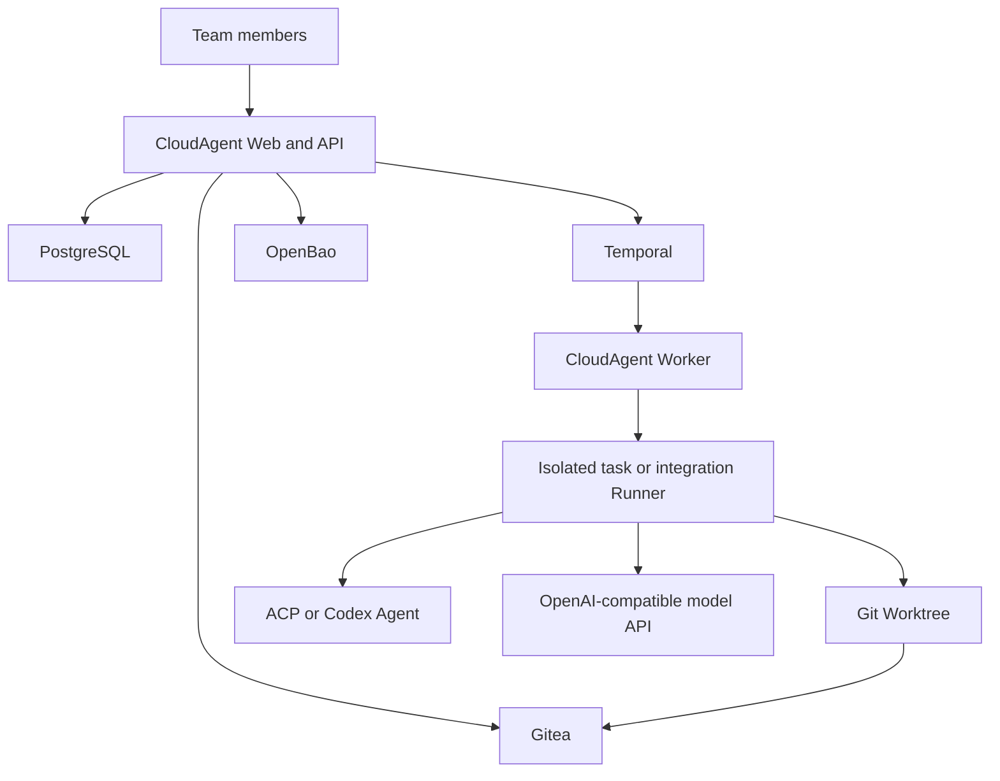

# CloudAgent

[](CHANGELOG.md)
[](LICENSE)
[](package.json)

CloudAgent is an open-source control plane for teams that want to develop one Git project with multiple people, multiple coding agents, and bring-your-own model credentials.

Each task receives an isolated Git branch, Worktree, and sandbox Runner. Team members can use an ACP/Codex adapter or provide only an OpenAI-compatible model API such as DeepSeek. CloudAgent supplies the hosted coding-agent tool loop, records real Git and verification evidence, and keeps final integration under Admin control.

> **Alpha software, local development only.** The default Compose stack uses development credentials and OpenBao development mode. Do not expose it to the public internet. Read [SECURITY.md](SECURITY.md) and [the security model](docs/SECURITY_MODEL.md) first.

## Why CloudAgent

- One canonical Git repository per project.
- One isolated branch, Worktree, Runner, and Agent session per task.
- Bring your own Agent, model provider, and API Key.
- Hosted tool calling for OpenAI-compatible model APIs.
- Shared progress based on real Commit, Diff, file, test, and build evidence.
- Dependency-aware task coordination and conflict warnings.
- Admin-controlled integration queue, conflict resolution, validation, and two-stage approval.
- Encrypted credential storage through OpenBao with versioning, leases, revocation, and audit events.
- Durable background workflows through Temporal.

## Architecture



The platform treats Agent messages as untrusted. Git state, changed files, verification output, approvals, and merge ancestry are calculated or verified by CloudAgent.

## Current Status

CloudAgent `v0.1.0-alpha` is a functional local MVP, not a hosted service or production-ready deployment.

Implemented:

- Multi-user authentication, project membership, invitations, and Admin/member roles.
- Private Gitea repositories and protected `main` branches.
- Task branches, independent Worktrees, Docker Runners, and application previews.
- Codex JSONL, ACP stdio, and OpenAI-compatible model API connections.
- A hosted `run_shell` coding loop for DeepSeek and compatible Chat Completions APIs.
- BYOK storage in OpenBao; PostgreSQL stores only references and lifecycle metadata.
- Agent sessions, events, cancellation, credential leases, permission requests, and audit trails.
- Change requests, dependency management, risk detection, integration queues, project validation, and two-stage merge approval.
- Remote task-branch and WIP checkpoint durability with workspace recovery.

Known production gaps are tracked in [docs/IMPLEMENTATION_STATUS.md](docs/IMPLEMENTATION_STATUS.md).

## Requirements

- macOS or Linux
- Docker Desktop or Docker Engine with Compose v2
- Git
- Node.js 20, 22, or 24
- pnpm 10 through Corepack
- At least 8 GB of available memory recommended for the full local stack

Windows users should use WSL2; it is not yet part of the validated matrix.

## Quick Start

Clone this repository, then run:

```bash
cd CloudAgent
corepack enable
pnpm install --frozen-lockfile
make bootstrap
make dev
```

Open [http://127.0.0.1:3210](http://127.0.0.1:3210).

Local development accounts:

| Role | Email | Initial password |
|---|---|---|
| Admin | `admin@cloudagent.local` | `cloudagent-admin-change-me` |
| Member | `member@cloudagent.local` | `cloudagent-member-change-me` |

These credentials are local fixtures. The UI forces an initial password change. Never reuse them outside local development.

Local services:

| Service | Address |
|---|---|
| CloudAgent | `http://127.0.0.1:3210` |
| Gitea | `http://127.0.0.1:3100` |
| OpenBao | `http://127.0.0.1:8200` |
| PostgreSQL | `127.0.0.1:5432` |

Stop the infrastructure with `make down`.

## Use DeepSeek as an Agent

1. Open **Add Agent** and select **Model API**.
2. Use provider `deepseek`, base URL `https://api.deepseek.com`, and model `deepseek-chat`.
3. Enter your own DeepSeek API Key. The Key is written to OpenBao, not PostgreSQL.
4. Assign the connection to a task and start its Worktree and Runner.
5. CloudAgent sends the task and tool definitions to DeepSeek, executes requested shell commands inside the isolated Runner, returns results to the model, and continues until completion.

No separate Agent API is required. The Agent is the combination of CloudAgent's hosted tool loop and the user's model API. Provider usage is still billed by that provider.

Other APIs can be used when they implement OpenAI-compatible Chat Completions tool calls.

## Development

Fast validation:

```bash
pnpm typecheck
pnpm test
pnpm build
```

Full release validation:

```bash
pnpm release:check
```

The integration smoke tests use PostgreSQL, OpenBao, Temporal, Git, and Docker. The OpenAI-compatible smoke test uses a local mock model server and does not consume external model credits.
Run `pnpm test:http-user-flow` to exercise authenticated pages and APIs with temporary users and a disposable Gitea repository.
Run `pnpm test:smoke` to execute all Docker, Temporal, Git, credential, Agent, workflow, and HTTP probes sequentially.

See [CONTRIBUTING.md](CONTRIBUTING.md) for the development workflow and [docs/IMPLEMENTATION_STATUS.md](docs/IMPLEMENTATION_STATUS.md) for the complete test matrix.

## Repository Layout

```text
apps/control-plane/              Next.js control plane, services, and Temporal worker
infra/                           Local Docker Compose stack and PostgreSQL migrations
scripts/                         Bootstrap, health checks, release checks, and smoke tests
docs/                            Product, architecture, security, and implementation notes
runtime/                         Local repositories and Worktrees; never committed
```

## Security

CloudAgent deliberately executes model-requested commands. Those commands run in task-specific sandbox containers, but this alpha is not a hardened multi-tenant security boundary. The default OpenBao root token, fixture passwords, HTTP endpoints, and local Docker access are unsuitable for public deployment.

Report vulnerabilities privately according to [SECURITY.md](SECURITY.md). Do not include API Keys, session cookies, or exploit details in public issues.

## Contributing

Contributions are welcome. Read [CONTRIBUTING.md](CONTRIBUTING.md), [CODE_OF_CONDUCT.md](CODE_OF_CONDUCT.md), and [THIRD_PARTY_NOTICES.md](THIRD_PARTY_NOTICES.md) before opening a pull request.

## License

CloudAgent is available under the [MIT License](LICENSE). Third-party packages and container images retain their own licenses.
